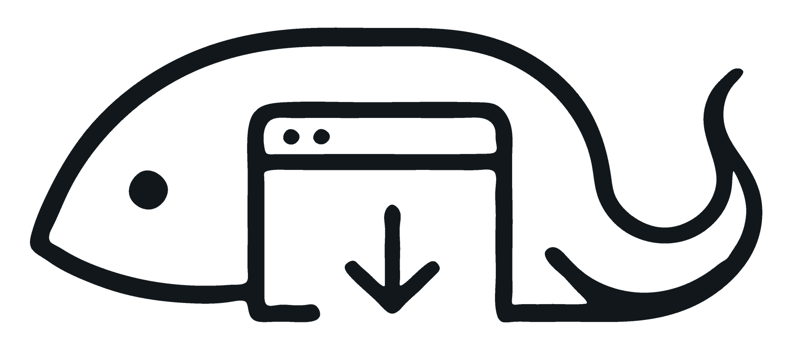

<p align="center"></p>

# LuzCrawl

通过真实浏览器搜索网页、提取正文和可见评论，保存 HTML、媒体与来源证据，并在本地复用检索经验。

仓库只分发 **一个 Skill**，内含 **2.7.0 编译后的采集运行文件与浏览器扩展**。无需编译，不提供单独压缩包。开发源码、测试、打包工具、源码映射和个人数据不随仓库分发。

## 安装

需要 Git、Node.js 24.5+ 和 Edge / Chrome。Windows PowerShell：

```powershell
git clone --depth 1 https://github.com/LuzernRR/luz-crawl.git "$env:TEMP\luz-crawl-install"
New-Item -ItemType Directory -Force "$env:USERPROFILE\.codex\skills" | Out-Null
Copy-Item -LiteralPath "$env:TEMP\luz-crawl-install\skills\luz-crawl" -Destination "$env:USERPROFILE\.codex\skills" -Recurse
Set-Location "$env:USERPROFILE\.codex\skills\luz-crawl"
npm install -g @jackwener/opencli@1.8.8
node scripts/luz-crawl.mjs install
opencli daemon restart
```

在浏览器扩展管理页开启开发者模式，选择“加载解压缩的扩展”，加载刚安装的 Skill 中的 **browser-extension/**，该文件夹内直接有 `manifest.json`。停用旧桥接副本，运行：

```powershell
node scripts/luz-crawl.mjs doctor
```

确认 `ready` 与 `extension_install.bundled_loaded` 均为 `true`，再在新对话使用 `$luz-crawl`。连接正常不代表目标网站已登录或正文可读。

升级前保留原 Skill 的 `opencli/memory/`；用新 Skill 替换旧目录，再恢复个人记忆、重载浏览器扩展并重新运行 `install`。更多排错见[安装说明](skills/luz-crawl/references/install.md)。

## 使用

以下命令均从安装后的 Skill 目录运行。一项需求创建一个任务目录，后续检索与采集复用该目录：

```powershell
$taskFolder = (node scripts/luz-crawl.mjs begin "浏览器自动化工具调研" --new | ConvertFrom-Json).folder
node scripts/luz-crawl.mjs search github "browser automation" --read 1 --out $taskFolder
node scripts/luz-crawl.mjs capture "https://example.com/article" --out $taskFolder
```

结果包含 HTML 与 `raw/` 来源证据；遇到登录或验证时手动完成，再用 `continue TASK_ID` 接续。搜索候选、已取得正文和未完成页面分别记录。

## 目录

| 路径 | 用途 |
| --- | --- |
| [skills/luz-crawl/SKILL.md](skills/luz-crawl/SKILL.md) | 唯一的 Skill 入口 |
| skills/luz-crawl/scripts/luz-crawl.mjs | 编译后的命令入口 |
| skills/luz-crawl/opencli/ | 编译后的采集插件与必要运行数据 |
| skills/luz-crawl/browser-extension/ | 可直接加载的浏览器扩展，脚本位于 dist/ |
| skills/luz-crawl/references/ | 安装、平台、浏览器接口与证据规范 |

[平台说明](skills/luz-crawl/references/platforms.md) · [浏览器接口](skills/luz-crawl/references/browser-api.md) · [验收边界](skills/luz-crawl/references/validation.md)

## 许可

原创部分采用 [PolyForm Noncommercial 1.0.0](LICENSE)，商业用途需另行授权。浏览器扩展保留 Apache-2.0，见[第三方说明](THIRD_PARTY_NOTICES.md)。
