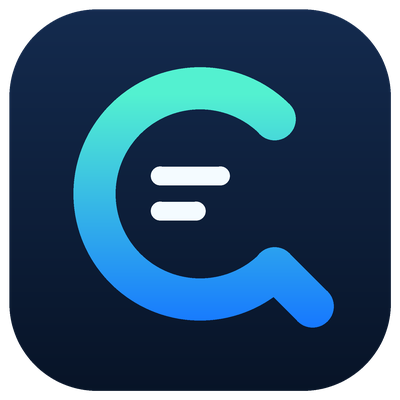

<p align="center"></p>

# LuzCrawl

**把 Skill、浏览器扩展和本地搜索记忆放在一起的网页采集工具。** 在真实 Edge / Chrome 中搜索、打开原文，保存 HTML、结构化字段、评论和可下载媒体；完成后关闭本次工具页面。遇到登录或验证码时保存任务，让用户手动完成后继续。

当前版本：**2.3.0 基础版**。53 个内置站点是搜索路线目录，不代表所有站点、账号和字段均已通过。具体实测见 [验证结果](skills/luz-crawl/references/validation.md)。

**许可：原创部分采用 PolyForm Noncommercial 1.0.0，禁止未经另行授权的商业用途。** 个人学习、非商业研究与实验可按许可使用和修改；第三方浏览器桥接部分保留 Apache-2.0。MIT 允许商用，因此本项目没有用 MIT 授权原创部分，也不将非商业许可称为 OSI 开源许可。完整边界见 [许可说明](#许可)。

## 目录

- [能做什么](#能做什么)
- [安装](#安装)
- [常用命令](#常用命令)
- [数据与下载](#数据与下载)
- [浏览器接口](#浏览器接口)
- [网站与技能](#网站与技能)
- [本地记忆](#本地记忆)
- [限制与排错](#限制与排错)
- [开发与贡献](#开发与贡献)
- [许可](#许可)

## 能做什么

| 功能 | 基础版行为 |
| --- | --- |
| 浏览器搜索 | 每次打开真实网页执行新的检索，历史记忆只建议路线和关键词 |
| 来源阅读 | 搜索卡片作为候选，打开详情并确认目标内容后才记为可读来源 |
| 社交字段 | 账号名称、账号标识、主页链接、标题、正文、图片、视频地址及封面 |
| 互动指标 | 点赞、评论、收藏、分享、浏览量；保留页面原值，隐藏数据为 `null` |
| 评论 | 尝试打开已知评论控件，合并本次实际加载的评论与相关讨论条目 |
| 媒体下载 | 下载页面观察到的图片和直接视频；可选使用已安装的 yt-dlp 下载公开视频 |
| HTML 归档 | 保存原 DOM 与计算样式，尝试内嵌图片和字体，附 raw 快照及 SHA-256 清单 |
| 人工接续 | 登录/验证码保留一个操作页，其余待办保存并关闭；完成后续接 |
| 浏览器动作 | 提供 read、scroll、screenshot、click、type 的受限 JSON 接口 |

账号、互动数、评论和媒体只来自当前页面实际暴露的信息。页面正文可读、账号字段齐全、媒体下载成功、评论完整是不同结果，会分别记录。

## 安装

### 运行环境

- Node.js **24.5+**，实测 24.15.0；Edge / Chrome 桌面版。
- 采集运行时基线：`@jackwener/opencli@1.8.8`；浏览器桥接协议基线：1.0.24。
- Python 3.12+ 仅用于打包、验证 Skill，不是日常采集的必需项。
- yt-dlp、FFmpeg / ffprobe 为可选视频下载与验证工具，需要在 `PATH` 中。

### 从仓库安装

```powershell
git clone https://github.com/LuzernRR/luz-crawl.git
cd luz-crawl/skills/luz-crawl
npm install -g @jackwener/opencli@1.8.8
node scripts/luz-crawl.mjs install
opencli daemon restart
```

在 Edge 打开 `edge://extensions`，Chrome 打开 `chrome://extensions`，启用开发者模式，选择“加载解压缩的扩展”，选中当前 Skill 的 **browser-extension/** 文件夹。该文件夹直接包含 `manifest.json`。停用旧的桥接扩展副本，避免重复连接。

```powershell
node scripts/luz-crawl.mjs doctor
```

确认 `ready: true`、`extension_install.bundled_loaded: true`，再执行一次真实搜索。多个浏览器资料时使用 `--profile ID`。连接成功不能证明平台已登录或内容已采集。

Codex 可安装仓库根目录的插件；也可将完整 `skills/luz-crawl/` 复制到自己的 `~/.codex/skills/luz-crawl/`。不要只复制 SKILL.md。已有其他版本运行时可用 `LUZ_OPENCLI_ROOT` 指向单独的安装，不必覆盖已有全局版本。

[Releases](https://github.com/LuzernRR/luz-crawl/releases) 提供完整 Skill、Codex 插件、原生采集插件、独立浏览器扩展四个 ZIP 及校验清单。首次安装和 ZIP 解压方式见 [安装文档](skills/luz-crawl/references/install.md)。

## 常用命令

以下命令从 Skill 文件夹运行。示例域名与关键词请换成自己的目标。

```powershell
# 浏览器搜索并打开前 1 个来源，读取已加载评论并下载媒体
node scripts/luz-crawl.mjs search xhs "人工智能" --read 1 --comments --download

# 直接打开原文；--resume 会先核验旧归档，再追加本次浏览器快照
node scripts/luz-crawl.mjs capture "https://example.com/article" --comments --download
node scripts/luz-crawl.mjs batch --file "参考链接.md" --resume

# GitHub 仓库检索、CSDN 技术文章、指定站点公开检索
node scripts/luz-crawl.mjs search github "browser automation" --read 1
node scripts/luz-crawl.mjs search csdn "Python 异步" --read 1
node scripts/luz-crawl.mjs search web "关键词" --site "example.com" --read 1

# 手动验证后续接；取消需明确指定任务
node scripts/luz-crawl.mjs pending
node scripts/luz-crawl.mjs continue TASK_ID
node scripts/luz-crawl.mjs cancel TASK_ID
```

`--read 0` 只检索，`--read 1..20` 打开对应数量的候选详情。`--scrolls 0..500` 控制滚动预算，预算耗尽会返回 `partial`。`--window background` 仍使用带扩展的真实浏览器。输出目录可单次指定 `--out DIRECTORY`。

## 数据与下载

未保存偏好时，输出到当前工作目录的 `outputs/luz-crawl/`；已保存的路径优先。

```text
outputs/luz-crawl/
├── 001_原标题.html
├── 002_原标题.html
├── 参考链接.md
└── raw/
    ├── 001_原标题/
    │   └── raw/
    │       ├── content.json
    │       ├── manifest.json
    │       ├── snapshots/
    │       ├── page.png
    │       ├── downloads.json
    │       └── media/
    └── tasks/
```

根目录只需要编号 HTML、一个参考链接.md 和一个 raw/。原始正文、评论、截图、媒体、诊断、安装包均在 raw 中。已有来源拒绝无提示覆盖；`--resume` 验证文件后追加当前快照。序号与原标题用于命名，不按主题再建一层目录。

`content.json` 的主要字段：

| 字段 | 含义 |
| --- | --- |
| `post.account` | `name`、`handle`、`profile_url`；未显示的值为 `null` |
| `post.text / images / videos` | 当前目标正文、观察到的图片、视频/封面；blob 地址不是可直接下载的文件 |
| `post.engagement` | 指标各含 `value`、`raw`、`approximate`；如 `2.1万` 保存 21000 并标明近似值 |
| `comments[]` | 条目 ID、作者、正文、时间、点赞与采集范围；缺失字段不猜测 |
| `comments_coverage` | 本次加载数量、页面显示总数和是否核验全量；基础版全量标志保持 `false` |
| `url_check` | 请求地址、落地地址、目标确认和内容可读结果 |
| `completeness / limitations` | 预算、停止原因、内容范围与限制 |
| `offline` | 图片/字体内嵌结果；失败时保留原地址并记录原因 |

```powershell
# DIRECTORY 使用采集结果中的 folder，不是输出根目录
node scripts/luz-crawl.mjs download DIRECTORY
node scripts/luz-crawl.mjs verify DIRECTORY
```

自动下载在本次工具页面关闭后执行。单图上限 25 MiB，单视频上限 250 MiB；媒体文件记录大小、MIME 与 SHA-256。下载不读取或导出 Cookie；使用已有的 HTTP_PROXY / HTTPS_PROXY / NO_PROXY 配置。登录保护的媒体、过期 CDN 链接和 DRM 视频可能下载失败。视频下载不等于音频转录、字幕完整或画面 OCR。

## 浏览器接口

保存 `actions.json`：

```json
[
  { "action": "read" },
  { "action": "scroll", "direction": "down", "amount": 600 },
  { "action": "screenshot" }
]
```

```powershell
node scripts/luz-crawl.mjs browser "https://example.com" --file actions.json
```

每次最多 20 步，只操作本次工具页，结束后关闭；结果与失败位置保存在 raw/tasks 中。`read` 可带 CSS `selector`；`click` 与 `type` 必须带唯一、可见的 CSS `selector`，`type` 还需 `text`，并显式传入 `--allow-write`。密码输入交给用户手动登录。接口不接受任意 JavaScript、Cookie 导出或 shell 命令。

`click` 只触发一次 DOM 点击，返回 `event_dispatched` 与 `effect_verified: false`；后续用 `read` 核验变化。依赖可信指针手势的控件需要另行验证适配器，不会自动重复点击。当前接口结果中的 `done` 表示该步骤已执行。

点赞、收藏、关注、评论发送等会修改外部账号，调用方必须先取得用户对具体平台、目标和内容的明确授权。基础版保留通用动作入口，尚无已验收的各平台点赞/发布适配器；当前测试使用本地表单与只读网页。

## 网站与技能

[完整 53 站目录](skills/luz-crawl/references/platforms.md) 和扩展弹窗中的 **LuzCrawl 使用说明** 列出网址、命令 ID、适合采集的信息与访问条件。核心能力全部由本 Skill 执行，不要求再安装其他平台 Skill。

| 类别 | 常见网站 | 对应技能 |
| --- | --- | --- |
| 社交内容 | 小红书、X、知乎、豆瓣、Reddit、微博、Instagram | 搜索原帖、账号、正文、图文、互动指标、已加载评论 |
| 视频 | 抖音、YouTube、B站、快手、TikTok | 视频简介、作者、封面、可见字幕/评论、可访问媒体下载 |
| 公众号 | 搜狗微信索引、微信公开文章 | 索引候选 → 打开公众号原文；不把索引摘要当全文 |
| 技术 | GitHub、Gitee、CSDN、博客园、掘金、Stack Overflow、DEV、Hacker News、V2EX | 仓库/文章/问题检索、公开正文与已加载讨论 |
| 搜索引擎 | Bing、Google、百度、搜狗、360、DuckDuckGo | 浏览器检索与指定域名发现 |
| 招投标采购 | 中国政府采购网、全国公共资源交易平台、采招网、千里马等 | 公开公告、项目条件、采购候选；需要打开原始公告核验 |
| 企业采购 | 1688、京东企业购、中国制造网、企查查、天眼查、爱企查 | 商品/企业候选与页面可见信息；登录/付费字段单独标明 |
| 数据与后台 | 灰豚、新榜、飞瓜、蝉妈妈、抖查查及各创作者后台 | 用户自己账号可见的页面数据；产品介绍页不算后台数据 |

GitHub 仓库检索只接受仓库根地址，排除 stars、forks 与站点导航。README、公开文件、Issue / PR 可直接 `capture` 对应 URL；基础版保存浏览器可见内容，不克隆整个仓库，也不承诺登录后代码搜索或所有折叠文件。

## 本地记忆

```powershell
node scripts/luz-crawl.mjs remember --out "D:\Research\LuzCrawl" --format html
node scripts/luz-crawl.mjs remember --platform "xhs,zhihu" --keywords "采购,家具"
node scripts/luz-crawl.mjs experience --query "家具" --platform xhs
node scripts/luz-crawl.mjs remember --site "https://example.com" --name example --template "https://example.com/search?q={query}"
```

记忆位于 `opencli/memory/`：preferences 保存用户明确指定的格式、路径和偏好；sites 保存新增网站；events 保存经核验的路线、关键词和失败；pending 保存人工待办。单次 `--out` 不改长期偏好。`LUZ_CRAWL_STATE` 可指定另一处个人状态目录。

发现 404、拒绝访问或失效链接时先检查网址、落地页、内容 ID 与真实站内入口，再尝试登记的同一内容公开入口。只有本次读到目标内容才记为成功经验；每次搜索仍重新打开浏览器。记忆不会自动训练模型。发布包不包含个人记忆、凭据、登录任务或原文归档。

## 限制与排错

- `awaiting_user`：手动登录或验证后 `continue TASK_ID`；最多保留一页，其余任务关闭并停放。不要破解验证码或越过付费权限。
- `partial`：可能是滚动预算、未展开正文、下载失败或关联链接未读完；查看 `limitations`。
- `blocked / failed`：保留 URL 和具体原因；404、访问拒绝、限流和传输错误不等于“未登录”。
- `doctor` 断连：核对浏览器扩展目录、旧副本、daemon、`--profile`。安装文件更新后需在扩展页重新加载。
- 浏览器调试横幅读取已加载扩展的名称。新扩展显示 LuzCrawl；协议头、运行时包名和第三方法律声明仍保留其原标识。

虚拟列表、分页、折叠回复、隐藏统计、登录后内容及站点改版都会影响范围。`captured` 只表示当前目标与停止条件达成；不表示全站、全部评论或全部视频已采集。基础版不是平台 API 的完整替代。

## 开发与贡献

代码在 `opencli/lib/`，CLI 在 `scripts/luz-crawl.mjs`，原生命令在 `opencli/commands.js`，站点目录在 `opencli/catalog.json`。浏览器扩展为 Manifest V3。

```powershell
node --test tests/*.test.mjs
python scripts/package.py --out outputs/packages
```

自动测试覆盖归档不覆盖、URL 校验、目标匹配、浏览器关闭、登录接续、下载与动作校验；真实浏览器和平台结果另行记录。[贡献说明](CONTRIBUTING.md)、[安全报告](SECURITY.md)、[更新记录](CHANGELOG.md) 提供提交与排错格式。

## 许可

- [LICENSE](LICENSE)：LuzCrawl 原创采集代码、Skill 和项目文档采用 **PolyForm Noncommercial 1.0.0**。
- 浏览器扩展中上游代码及该扩展的分发采用 **Apache-2.0**，保留 [browser-extension/LICENSE](skills/luz-crawl/browser-extension/LICENSE) 与 [NOTICE](skills/luz-crawl/browser-extension/NOTICE)。原许可赋予的第三方权利不会被本项目的非商业条款撤回。
- 单独安装的运行时与其他依赖使用各自许可，见 [第三方说明](THIRD_PARTY_NOTICES.md)。
- 抓取的文章、图片、视频、评论属于原作者或平台；项目许可不授予这些内容的转载或商用权利。

商业产品集成、出售采集服务、收费二次分发或其他商业用途，需联系 [LuzernRR](https://github.com/LuzernRR) 取得另行许可。下载或能运行代码不等于获得商业授权。

文档结构参考 [Best-README-Template](https://github.com/othneildrew/Best-README-Template)；许可原文来自 [PolyForm 官方仓库](https://github.com/polyformproject/polyform-licenses/blob/1.0.0/PolyForm-Noncommercial-1.0.0.md)。
